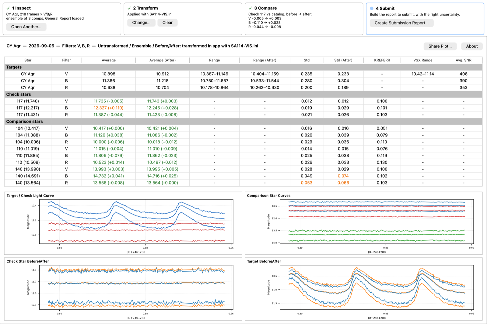

# Photometry Workbench

A desktop app for photometry processed in the AAVSO's VPhot. Open a
session's AAVSO report, see how good it is, apply your transform (single comparison
star or ensemble), check what the transform changed, and save a report ready to
upload to the AAVSO with WebObs.

<br>



<br>

What it does:

- **Inspect** a session: target, check star and every comparison star against the
  catalog, with the problems flagged and the reason on hover. Light curves for the
  target, check and comps, plus VPhot's SNR, FWHM, sky and peak counts.
- **Transform** with your Transform Generator (TG) coefficients,
  for a single comparison star (the same results as TransformApplier) or an
  **ensemble**, which TransformApplier doesn't do.
- **Compare** the check star and comps against the catalog before and after.
- **Submit**: choose how to report the uncertainty with a few questions (combine
  frames or not, does the target vary), preview the rows, and save an AAVSO Extended
  Format file. For an ensemble light curve the uncertainty comes from the spread of
  the target's estimates across the comparison stars.

## Install

You need Python 3.10 or newer. On a Mac the built-in `python3` is too old (3.9);
install a current one from [python.org](https://www.python.org/downloads/) or with
Homebrew (`brew install python`).

The easiest way to install the app is [pipx](https://pipx.pypa.io), which keeps it in
its own environment and puts the `photometry-workbench` command on your path:

```
brew install pipx        # or: python3 -m pip install --user pipx
pipx ensurepath          # then open a new terminal window
pipx install git+https://github.com/jeffrwatts/PhotometryWorkbench
```

Then start it with:

```
photometry-workbench
```

To update to the latest version: `pipx reinstall photometry-workbench`.

The app has been used on macOS. It should run on Windows and Linux (it's
Python and Qt), but hasn't been tested there yet.

## Using it

The [user guide](docs/user-guide.md) walks through a real session from VPhot export
to the saved report, including which VPhot export options to choose and how the
uncertainty is chosen.

## How the ensemble transform works

[`notebooks/ensemble_transform_walkthrough.ipynb`](notebooks/ensemble_transform_walkthrough.ipynb)
walks through the method step by step on a real session (CY Aqr, 2026-09-05), using
the app's own code: the single-comp transform checked against TransformApplier, how
each comparison star's instrumental magnitude is recovered from VPhot's ensemble
report and General Report, and why the spread across comparison stars is the
uncertainty.

## Running from source

```
git clone https://github.com/jeffrwatts/PhotometryWorkbench
cd PhotometryWorkbench
python3 -m venv .venv
.venv/bin/pip install -e ".[dev]"
.venv/bin/photometry-workbench
.venv/bin/pytest
```

For the notebook, install `".[notebook]"` as well and open it with Jupyter from the
`notebooks` folder.

## License

MIT; see [LICENSE](LICENSE). This is an independent project, not affiliated with or
endorsed by the AAVSO.
