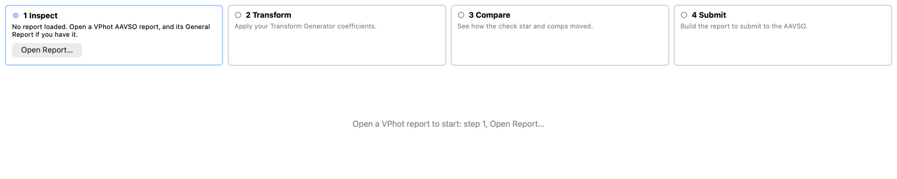
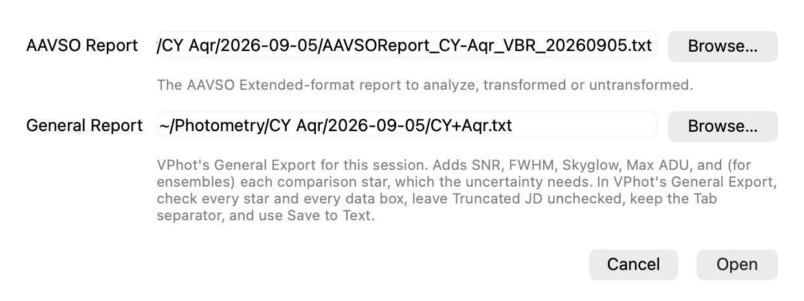
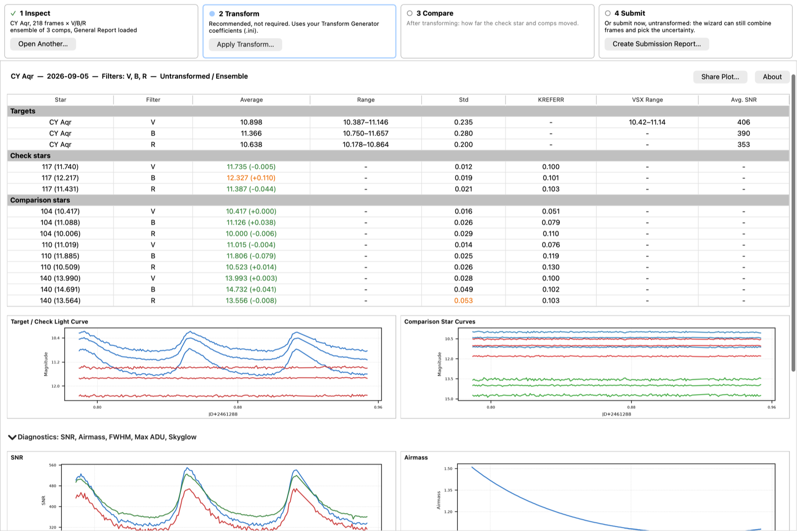
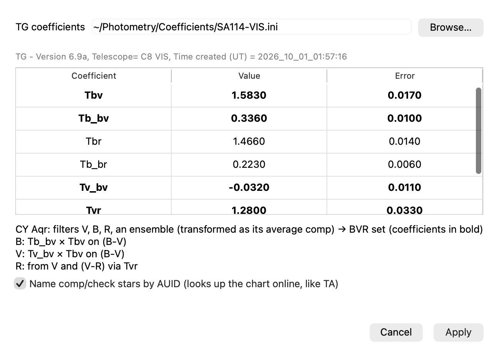
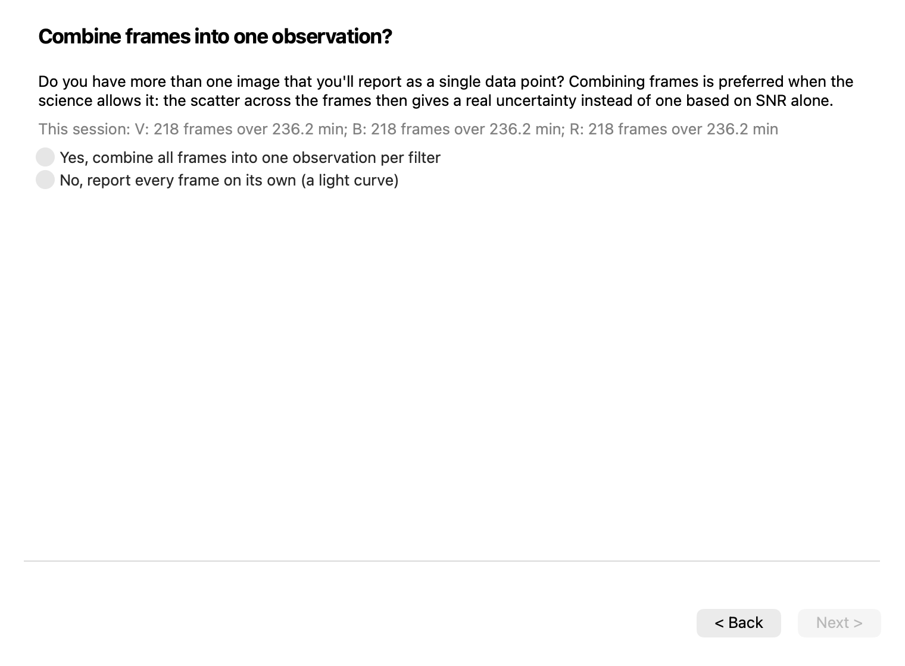
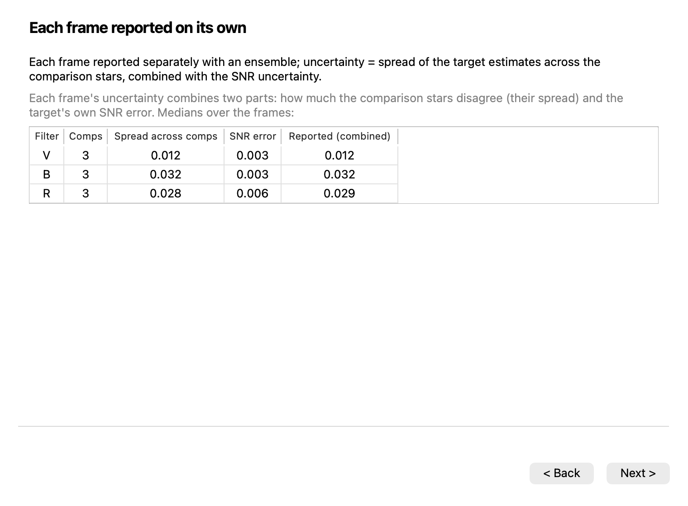
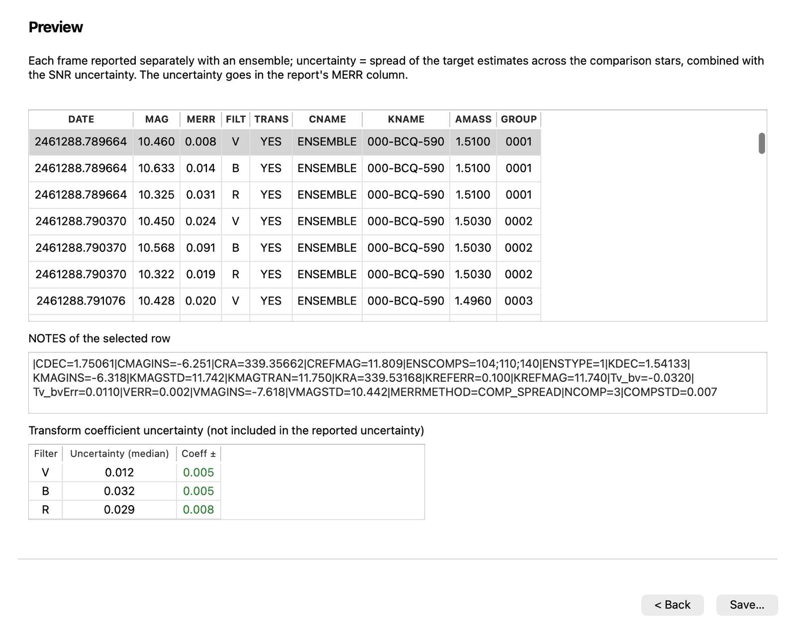
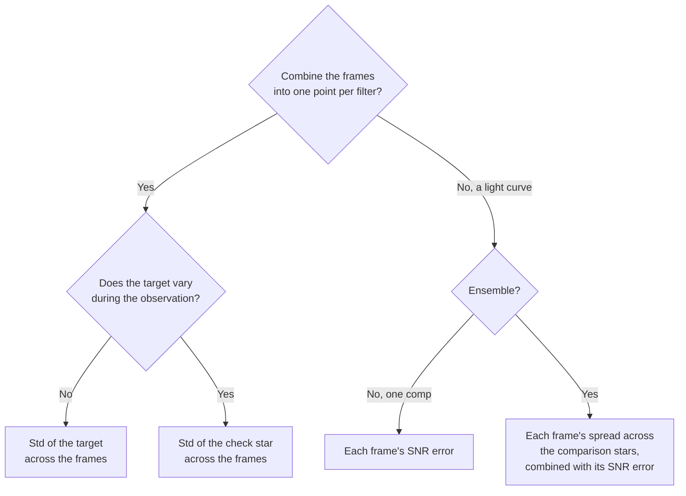
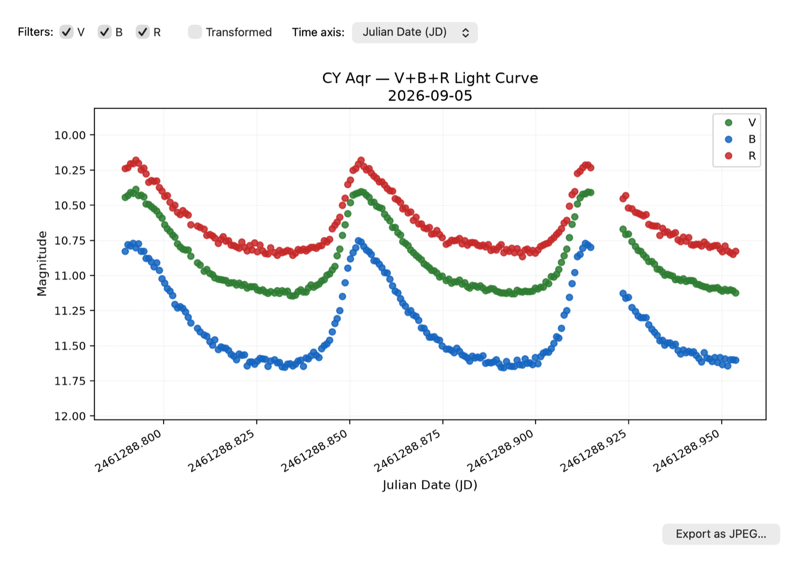

# Photometry Workbench user guide

This guide follows one real session from VPhot to a saved AAVSO report: CY Aqr on
2026-09-05, 218 frames each in B, V and R from a one-shot color camera, measured in
VPhot against an ensemble of three comparison stars (104, 110, 140) with 117 as the
check star. The same session is in
[`notebooks/data/cy-aqr-2026-09-05`](../notebooks/data/cy-aqr-2026-09-05) if you want
to follow along.

- [What you need](#what-you-need)
- [Exporting from VPhot](#exporting-from-vphot)
- [Step 1: Inspect](#step-1-inspect)
- [Step 2: Transform](#step-2-transform)
- [Step 3: Compare](#step-3-compare)
- [Step 4: Submit](#step-4-submit)
- [How the uncertainty is chosen](#how-the-uncertainty-is-chosen)
- [Sharing a light curve](#sharing-a-light-curve)
- [Settings, network and limitations](#settings-network-and-limitations)

## What you need

- **The AAVSO report** VPhot creates for the session (AAVSO Extended Format, usually
  named like `AAVSOReport_CY-Aqr_VBR_20260905.txt`). Untransformed is the usual case;
  a report already transformed by TransformApplier can be inspected and submitted too.
- **The General Report** (VPhot's General Export) for the same session. It's optional,
  but it adds the per-frame SNR, FWHM, sky and peak counts, and for an ensemble it
  carries each comparison star's magnitude, which the ensemble's uncertainty needs.
- **Your Transform Generator coefficients** (the `.ini` file TG saves), if you want
  to transform. The transform needs B and V, or B, V and R.

## Exporting from VPhot

Save the AAVSO report from VPhot's time series results as usual. Then, for the same
session, use the General Export and set it up like this:

- **Select other stars to report:** check every star, including every comparison
  star of an ensemble. The app checks this: an ensemble's comparison stars must
  average to the reference magnitude VPhot used (CREFMAG in the report), and a General
  Report missing one is refused.
- **Include the following data:** check every box (Julian Date, Filter, Airmass,
  Error, SNR, FWHM, Skyglow, Max ADU, Instrumental Magnitude). Julian Date and Filter
  are required; without the others, their charts are missing.
- **Truncated JD:** leave it unchecked. Truncated dates can't be matched to the AAVSO
  report.
- **Separator:** Tab.
- **Save to Text.**

If a General Report can't be used, the app says why when you open it, opens the AAVSO
report without it, and you can add a corrected one later from step 1.

## Step 1: Inspect

The app opens empty. Across the top is the four-step strip; each step shows where it
stands and the button that moves it along.

**Open Report…** asks for the AAVSO report and, optionally, the General Report. The
General Report's Browse starts in the AAVSO report's folder, since they're usually
saved together.

The main window then shows one table for the session, with a row per star and filter:

- **Targets:** the target's average, range and scatter (Std) per filter, the known
  V range from VSX, and the average SNR.
- **Check stars:** the check star's average measured magnitude, with its catalog
  value in the Star column and the offset in brackets, and its Std and catalog error
  (KREFERR).
- **Comparison stars** (ensembles): each comparison star measured against the
  others, the same way VPhot's comparison rows are, against its catalog value.

Color marks something worth a look, not a grade; hover over a colored cell for the
reason.

- An average is **green** within the catalog error, **orange** when it's off by
  more than the catalog error, and **red** when off by more than twice it. In this
  session the check star is 0.110 off in B before the transform, outside its ±0.101.
- A **Std** is colored only above 0.05 mag (typical sessions are 0.01 to 0.03).
- A target's **range** is colored only when it goes more than 0.1 mag past the VSX
  range; falling short of it is normal for a session that doesn't cover a full cycle.

Below the table are the light curves of the target, check star and comparison stars,
and a collapsible **Diagnostics** section with SNR, airmass, FWHM, Max ADU and skyglow
through the night. Click any chart to open it larger.

## Step 2: Transform

The transform is recommended but not required; you can go straight to step 4 and
submit untransformed (TRANS=NO).

**Apply Transform…** asks for your TG coefficients file and shows which coefficients
it will use (in bold) and how each filter is transformed. The file is remembered for
next time.

- **Single comparison star:** the same transform TransformApplier does, giving the
  same magnitudes.
- **Ensemble:** the ensemble is transformed as its average comparison star. VPhot's
  report carries that average star's instrumental and catalog magnitudes, and because
  the transform is linear, this gives the same magnitudes as transforming against each
  comparison star and averaging. Every comparison star must be measured in every
  filter, or the "average star" would be a different set of stars in each filter.
- **Name comp/check stars by AUID** looks up the chart online and uses AAVSO star
  identifiers in the report, as TransformApplier does.

With a General Report, the app also transforms each comparison star's estimate of the
target separately and checks that they average to the ensemble result. If they don't
(for example, a comparison star dropped out of some frames), it warns you.

## Step 3: Compare

After the transform, the table gains **(After)** columns, and the Compare step lists
the check star's offset from catalog before and after:

Here the check star in B moved from +0.110 to +0.028, now inside its catalog error,
and comp 110's B offset dropped from −0.079 to −0.023. Two new charts show the check
star and target before and after the transform.

If the check star is still outside its catalog error after the transform, its tooltip
suggests what to look at: the coefficients, the chart's catalog values, or the
comparison star.

## Step 4: Submit

**Create Submission Report…** opens a short wizard. It first asks whether to submit
the transformed or the untransformed magnitudes, then:

**Combine frames into one observation?** Yes reports one point per filter, the mean of
all its frames; No reports every frame (a light curve). For CY Aqr, a pulsating star
that goes through about 0.75 mag in V every 88 minutes, it's No.

When combining, the next question is whether the target varies during the
observation, with the target's and check star's scatter shown to help you decide.

For a light curve with an ensemble, the uncertainty combines the spread across the
comparison stars with the SNR error:

The **Preview** shows the rows that will be saved, with each row's NOTES (including
the method, the comparison stars and their spread) and how much the transform
coefficients' own errors move the result (shown for reference, not added in).

**Save…** writes the file next to the AAVSO report, named like
`AAVSOReport_CY-Aqr_VBR_20260905_submit.txt`. Upload it with WebObs (File upload).

## How the uncertainty is chosen

The wizard follows the uncertainty decision tree taught in the AAVSO CHOICE course
*Uncertainty about Uncertainty* (Aaron Price, with Arne Henden, Matthew Templeton and
Mike Simonsen, 2012), and extends it to ensemble light curves, which the course doesn't
cover. In the app's terms:

- **Target's Std:** when the target is steady (a supernova over a few minutes, a slow
  variable), its own scatter across the frames is the most direct measure.
- **Check star's Std:** when the target may change, its scatter includes real
  variation, so the scatter of a check star is used instead. It should be within 2 mag
  of the target; the wizard warns when it isn't.
- **SNR error:** a single frame against a single comparison star has nothing to take
  a scatter of, so the SNR-based error is all there is.
- **Spread across comparison stars:** with an ensemble, each comparison star gives
  its own estimate of the target in every frame. How much they disagree is a measured
  uncertainty, and it's combined with the target's SNR error (added in quadrature).
  This usually matches the check star's actual scatter through the night far better
  than the SNR error alone: for this session, 0.012/0.032/0.029 in V/B/R against the
  check star's 0.012/0.029/0.026.

For combined points, the preview also compares the scatter across frames with what a
single frame's uncertainty predicts, and flags a scatter 1.5 times or more higher.

## Sharing a light curve

**Share Plot…** (top right) makes a presentation light curve of the target, as
reported or transformed, for any filters, with the time axis in JD, UTC or your
computer's local time. **Export as JPEG…** saves it.

## Settings, network and limitations

- **Remembered between runs:** the last folder you opened from, the TG coefficients
  file, and whether Diagnostics is open.
- **Network:** the app looks up the chart's catalog magnitudes (for the comparison
  stars) and the target's VSX range online, and keeps a copy of each chart so it works
  offline afterwards. Without the network the session still opens; what needs the
  catalog says so.
- **Cameras:** developed with a one-shot color camera, where every frame has B, V and
  R taken at once. Filtered (monochrome) sessions, where the filters are taken in
  turn, should work, but haven't been tested yet.
- **Platforms:** used on macOS; Windows and Linux are untested.

Questions and problem reports are welcome on the
[GitHub issues page](https://github.com/jeffrwatts/PhotometryWorkbench/issues).
